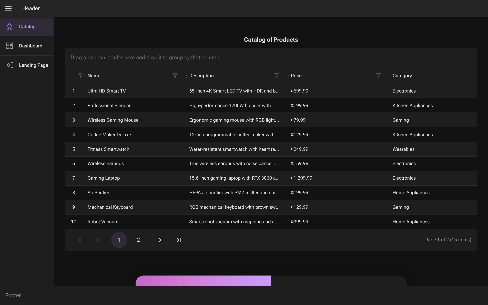
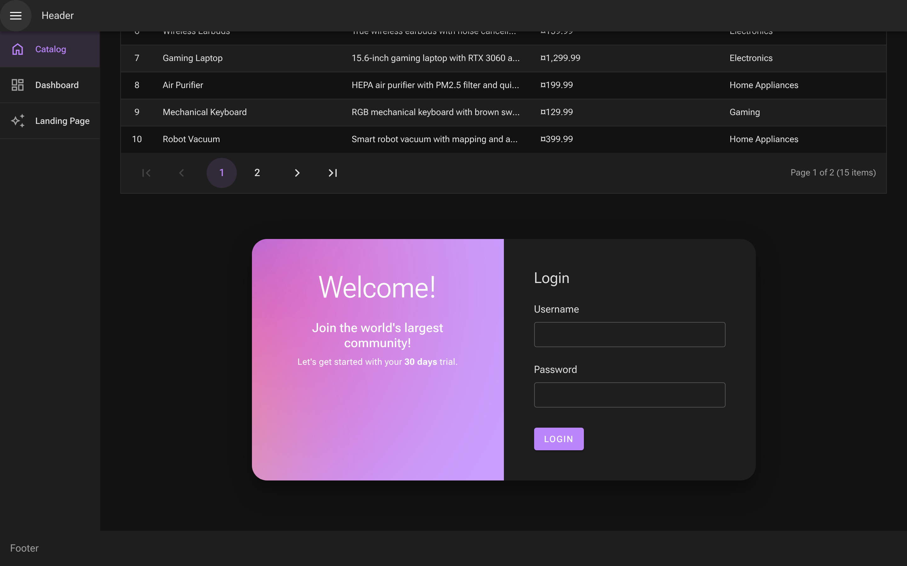

<div align="center">

# 🛒 EShop

**Catálogo de productos para e-commerce construido con Blazor Web App (.NET 8) y Radzen Blazor**


</div>

---

## 📸 Capturas de pantalla

### Catálogo de productos
Tabla interactiva con filtrado avanzado, ordenamiento, agrupación por columnas, redimensionado y paginación.



### Página de bienvenida e inicio de sesión
Tarjeta de bienvenida con fondo degradado y formulario de login de Radzen.



---

## 📖 Descripción

**EShop** es una aplicación web de comercio electrónico que muestra un catálogo de productos usando el modelo de renderizado híbrido de **Blazor Web App** (`InteractiveAuto`: Server + WebAssembly). La interfaz utiliza la librería de componentes **Radzen Blazor** con el tema `material-dark`.

Actualmente los datos provienen de una fuente simulada (`MockData.cs`) con **15 productos** en 6 categorías: Electronics, Gaming, Home Appliances, Kitchen Appliances, Personal Care y Wearables.

## ✨ Características

- 📋 **Catálogo de productos** con `RadzenDataGrid`:
  - Filtrado avanzado por columna (operador lógico `OR`)
  - Ordenamiento y redimensionado de columnas
  - Agrupación arrastrando encabezados
  - Paginación (10 elementos por página) con resumen
  - Badges de estado de stock (*In Stock* / *Out of Stock*)
- 🎨 **Layout responsive** con header, sidebar colapsable y footer (`RadzenLayout`)
- 🔐 **Landing page** con formulario de login (`RadzenLogin`)
- 🌙 **Tema oscuro** Material de Radzen
- ⚡ **Renderizado interactivo automático** (Server → WebAssembly)

## 🧱 Stack tecnológico

| Capa | Tecnología |
|------|------------|
| Framework | ASP.NET Core 8 – Blazor Web App |
| Renderizado | Interactive Server + Interactive WebAssembly (`InteractiveAuto`) |
| UI | [Radzen.Blazor](https://blazor.radzen.com/) 5.6.0 |
| Lenguaje | C# 12 / Razor |
| Datos | Datos mock en memoria (EF Core referenciado para futura persistencia) |

## 📁 Estructura del proyecto

```
EShop/
├── EShop-app.sln
├── EShop-app/                     # Proyecto servidor (host)
│   ├── Program.cs                 # Configuración de servicios y pipeline
│   ├── Components/
│   │   ├── App.razor              # Documento raíz, tema Radzen
│   │   ├── Routes.razor           # Enrutador
│   │   ├── Layout/
│   │   │   └── MainLayout.razor   # Header, sidebar, body y footer
│   │   ├── Pages/
│   │   │   ├── ProductCatalog.razor   # /ProductCatalog
│   │   │   ├── LandingPage.razor      # /LandingPage
│   │   │   └── Error.razor
│   │   ├── Data/
│   │   │   └── MockData.cs        # Productos de ejemplo
│   │   └── Services/
│   │       └── NorthwindService.cs
│   └── wwwroot/                   # Archivos estáticos
├── EShop-app.Client/              # Proyecto cliente (WebAssembly)
└── docs/screenshots/              # Capturas usadas en este README
```

## 🚀 Primeros pasos

### Requisitos previos

- [.NET 8 SDK](https://dotnet.microsoft.com/download/dotnet/8.0)
- (Opcional) Visual Studio 2022 17.8+, Rider o VS Code con C# Dev Kit

### Instalación y ejecución

```bash
# Clonar el repositorio
git clone https://github.com/GEKKOLAS/EShop.git
cd EShop

# Restaurar dependencias y compilar
dotnet build

# Ejecutar la aplicación
dotnet run --project EShop-app --launch-profile http
```

Luego abre en el navegador:

| Página | URL |
|--------|-----|
| Catálogo de productos | http://localhost:5283/ProductCatalog |
| Landing page / Login | http://localhost:5283/LandingPage |

> Con el perfil `https` la app también escucha en `https://localhost:7235`.

## 🗺️ Hoja de ruta

- [ ] Página de inicio en la ruta raíz `/`
- [ ] Página de **Dashboard** (ya enlazada en el sidebar)
- [ ] Persistencia real con Entity Framework Core
- [ ] Autenticación funcional en el formulario de login
- [ ] Carrito de compras y checkout
- [ ] Imágenes de productos en `wwwroot/images`
- [ ] Mejorar la vista en dispositivos móviles

## ⚠️ Problemas conocidos

- La ruta raíz `/` devuelve **404**; usa `/ProductCatalog` o `/LandingPage`.
- `MainLayout.razor` renderiza el catálogo y la landing page en todas las rutas, por lo que el contenido se duplica al navegar.
- Los precios aparecen con el símbolo genérico `¤` porque no se define una cultura (p. ej. `en-US`) en la aplicación.
- Las imágenes referenciadas en `MockData.cs` (`/images/*.jpg`) aún no existen en `wwwroot`.
- El paquete `Microsoft.AspNetCore.Components.WebAssembly.Server` 8.0.10 tiene una vulnerabilidad conocida ([GHSA-qjpx-jqm5-h2c4](https://github.com/advisories/GHSA-qjpx-jqm5-h2c4)); se recomienda actualizar a la última versión 8.0.x.

## 🤝 Contribuir

1. Haz un fork del proyecto
2. Crea una rama: `git checkout -b feature/nueva-funcionalidad`
3. Haz commit de tus cambios: `git commit -m "Agrega nueva funcionalidad"`
4. Haz push a la rama: `git push origin feature/nueva-funcionalidad`
5. Abre un Pull Request

## 👤 Autor

**GEKKOLAS** – [github.com/GEKKOLAS](https://github.com/GEKKOLAS)

---

<div align="center">
Hecho con ❤️ usando Blazor y Radzen
</div>
